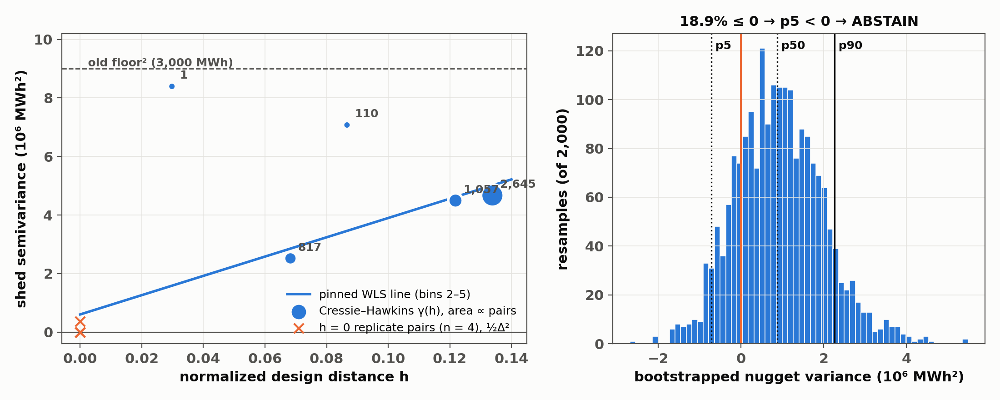
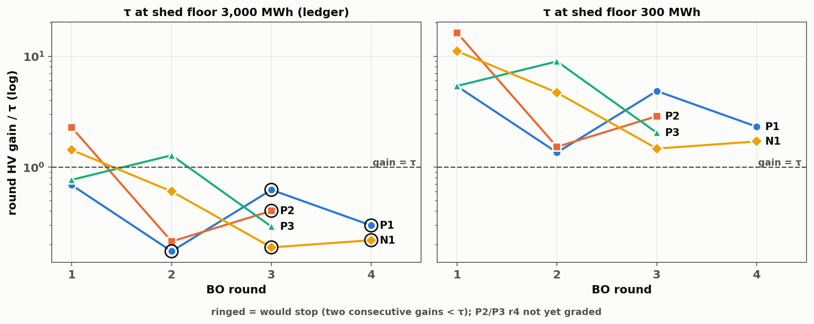

# Shed noise-floor re-estimate (prompt 40)

Status 2026-10-21. Branch `floor40` from origin/d6 `2a604ff`. Zero PCM runs.
No ledger, wave, fits.json or holdout file changed.

## Result

**The shed floor is INDETERMINATE (pre-registered ABSTAIN branch).**

- The data we own cannot separate the shed floor from zero.
- Part B (GP refits) did not run, as the rule requires.
- Part C ran as a sensitivity band, at shed floor 300 and 3,000 MWh.
- The answer to 1016-D2 is the replicate study (NXT-D3).

| quantity | value |
|---|---|
| pinned nugget, point estimate | 6.05e5 MWh² (sd 778 MWh) |
| bootstrap nugget variance p5 / p50 / p90 | −7.14e5 / 8.83e5 / 2.27e6 MWh² |
| resamples with nugget ≤ 0 | 18.9 % |
| floor_new = √p90 | 1,505 MWh |
| branch | **ABSTAIN** (p5 ≤ 0) |
| robustness (a) space-filling + grid only | √p90 1,631 MWh, p5 < 0 → ABSTAIN |
| robustness (b) holdout `random_C` removed | √p90 1,495 MWh, p5 < 0 → ABSTAIN |

Both robustness rows give the same branch. No escalation is necessary.

The §0.1 expectation was "most likely below 3,000". The point estimate and
√p90 are below 3,000, but the bootstrap does not exclude zero. Thus the data
does not support a new number.

## 1. Pool and G0

Pool: 1,573 scenario-C runs (ρ = 2.0, B = 40, d = 6).

| group | runs | waves |
|---|---|---|
| space-filling | 192 | `stage2_C_n0`, `stage2_C_n0b`, `methods_C_Q1–Q3`, `random_C`, `methods_C_S2_n0`, `methods_C_S3_n0` |
| BO rounds | 112 | `bo_C_r1/r2`, `methods_C_P1_r3/r4`, `methods_C_P2_r1–r3`, `methods_C_P3_r1–r3`, `methods_C_N1_r1–r4` |
| grid | 1,269 | `sweep_C`, `contour_303x317_C`, 14 `pairgrid_*_C` |

Not in the pool:
- `methods_C_P2_r4` and `methods_C_P3_r4`: no objectives yet.
- Scenario A/B waves, `screening` and `stage2_backfill_C`: excluded by the
  prompt.

**Solver settings are the same in every pooled wave.**
- All pooled waves run `multi_pem/multi_PEM_PCM.py` with no solver flags:
  `ruc_mipgap` 0.01, Gurobi, SCED threads 1.
- On d6, the driver and `multi_pem/parameters.py` were last changed on
  2026-08-22. That is before the first pooled C objectives (2026-09-06).

**G0 PASS.**
- 4,630 pairs have 0 < h < 0.15 (the threshold is 20).
- Smallest nonzero h = 0.0298.
- The prompt's measured expectation was about 4,758 pairs and h ≈ 0.0066.
  - The pair count under the pinned convention is within 3 % of that.
  - No convention I tested gives h = 0.0066 (raw ω: 0.0283; blank = 0.05:
    0.0039).
  - Thus I used the pinned convention: blank → ω = 0.0, normalized by the
    lattice range 0.05–1.0.

**Disclosure: the small-h mass is grid.**
- Of the 4,630 pairs, 4,530 are grid–grid, 95 are BO–grid, 4 are BO–BO and
  only 1 is space-filling–space-filling.
- Grid points use blank (unretrofitted) tiers, encoded as ω = 0.0. That puts
  them off the 0.05-floor lattice, on sparse-retrofit axes and planes, not in
  the BO region.
- So the nugget estimate describes noise on those subspaces.

**Disclosure: pv_324 is out of pool.**
- The current 3,000 MWh floor comes from one triplet (pv_324, Δshed spread
  +2,193 / −2,293) in the d = 14 `screening` wave.
- That wave used pre-scenario-C settings (ρ empty).
- So the current floor rests on runs from a different configuration.

## 2. Part A: the nugget

The bins were pinned and committed (`45562e0`) before any semivariance was
computed:
- Cressie–Hawkins estimator, 6 bins of width 0.025 on (0, 0.15).
- WLS line over the 4 smallest populated bins; weights = pair counts.
- Bootstrap: 2,000 resamples of the design points, seed 20261021.
- h = 0 pairs are not used in the fit.

| bin (h) | pairs | mean h | γ_CH (MWh²) |
|---|---|---|---|
| 0.025–0.05 | 1 | 0.030 | 8.39e6 |
| 0.05–0.075 | 817 | 0.068 | 2.52e6 |
| 0.075–0.10 | 110 | 0.087 | 7.07e6 |
| 0.10–0.125 | 1,057 | 0.122 | 4.49e6 |
| 0.125–0.15 | 2,645 | 0.134 | 4.67e6 |

γ is not monotone in h. The intercept therefore depends strongly on the fit
choices.

**Sensitivity rows (reported only, never floor_new):**

| variant | nugget variance (MWh²) | sd (MWh) |
|---|---|---|
| bin width 0.0125 | −6.74e5 | — |
| bin width 0.05 | 8.95e5 | 946 |
| k = 3 bins | −1.31e7 | — |
| k = 5 bins | 1.00e6 | 1,000 |
| classical estimator | 9.68e4 | 311 |
| power law, all bins | −2.40e7 | — |

Half of the variants give a negative intercept.

**Method resolution check** (`check_estimator.py`). I used the real pooled
design geometry with a known noise.
- **Pure noise:** the estimator recovers σ² within 4 % at σ = 300, 1,000
  and 3,000 MWh. The code is correct.
- **Smooth function plus noise:** I added a smooth function at the shed
  scale (pool shed sd 13,549 MWh; f = 20,000·Σx).
  - Noise-free, the function alone gives γ_f rising from 0 to 3.2e6 MWh²
    over the observable h.
  - The pinned line through that γ_f has intercept −3.9e6 MWh².
  - As a result, σ = 300 and 1,000 give negative nuggets in 100 % of
    trials, and σ = 3,000 recovers only 58–74 % of σ².
- **Conclusion:** with the smallest observable h at 0.03–0.07, the
  extrapolation cannot separate a floor of about 2,000 MWh or less from
  function curvature. The smoothness assumption fails at the h we can see.
  The ABSTAIN is a property of the data, not of the code.

**Replicate observations (h = 0, reported separately).** There are four
cross-wave identical-design pairs, not one.

| pair | \|Δshed\| MWh | \|Δcurt\| MWh | \|Δcost\| $ |
|---|---|---|---|
| `methods_C_P1_r3:8` ≡ `methods_C_P2_r1:5` (known) | 26.7 | 1,131 | 166,867 |
| `bo_C_r2:3` ≡ `methods_C_P2_r3:6` | 61.6 | 378 | 16,000 |
| `methods_C_P1_r3:3` ≡ `methods_C_P3_r2:3` | 861.9 | 175 | 72,256 |
| `methods_C_P1_r4:8` ≡ `methods_C_P3_r3:1` | 0.0 | 0.0 | 1,100 |

- Pooled replicate sd = √(mean Δ²/2) = 306 MWh, from n = 4 pairs.
- Identical inputs in different waves do not always replay byte-identically.
  Three of the four pairs differ.
- n = 4 is too small to set a floor. It is the seed of the NXT-D3 replicate
  study.

**Heteroscedasticity check (report, not branch).**
- Strata by pair-mean shed:
  - 0–22.7k MWh: nugget −4.6e5
  - 22.7k–38.1k MWh: −2.8e6
  - 38.1k–46.5k MWh: +3.15e6 (sd 1,775)
- The log1p-space nugget is negative (point −6.4e-3; 99.4 % of resamples
  ≤ 0). Thus the √nugget_t·(1 + y_med) reconciliation is undefined.
- **Flag:** only the high-shed stratum shows a positive nugget, so the noise
  can be level-dependent. Any future floor_new is level-averaged. The
  heteroscedastic noise model is the Phase-B follow-up prompt.

**Curt and cost cross-check (report only; campaign floors do not change).**

| objective | √p90 | old floor | ratio | resamples ≤ 0 |
|---|---|---|---|---|
| curtailment | 28,120 MWh | 5,000 | ×5.6 | 41.5 % |
| cost_ls | $8.20M | $0.5M | ×16.4 | 0 % |

I investigated these large differences:
- At small h the grid pairs move along single axes where curtailment and
  cost change steeply. So γ at h ≈ 0.07 is function variation, not noise
  (the same bias as the check above).
- The h = 0 replicates show |Δcost| of $1.1k–$167k, well below $0.5M.
- So these nuggets are not noise estimates. This is the same failure as for
  shed, and it does not show that the old curt or cost floors are too small.
  No change.

## 3. Part B: shed GP under floor_new

**Not run.** The ABSTAIN branch skips the Part B refits (§2 A3). The 9-panel
shed row is not regenerated. No holdout touch #3 occurred.

## 4. Part C: per-arm τ and stop-rule re-grade (sensitivity band)

Recipe from `acquire_next.py`, unchanged:
- N = 1,000 draws, MC seed 20261006, all 32 starts of the arm perturbed.
- Exact HV against the ledger-frozen ref.
- Curt and cost floors fixed at 5,000 / 0.5e6.

The 3,000 MWh row reproduces every ledger τ exactly (asserted to 1e-12).

| arm | τ_old (ledger) | % HV₀ | τ at 300 MWh | % HV₀ | ratio | first would-stop (3,000) | break-even shed floor |
|---|---|---|---|---|---|---|---|
| P1 | 5.263e16 | 7.97 % | 6.77e15 | 1.02 % | 0.129 | r2 (live stop) | **1,997 MWh** |
| P2 | 7.472e16 | 4.75 % | 1.05e16 | 0.67 % | 0.140 | r3 | 1,133 MWh |
| P3 | 7.123e16 | 4.56 % | 1.01e16 | 0.65 % | 0.142 | none (r1–r3) | — |
| N1 | 5.263e16 | 7.97 % | 6.77e15 | 1.02 % | 0.129 | r3 | 1,726 MWh |

- **Break-even floor:** the smallest shed floor at which the first recorded
  stop still fires. Below it, the stop becomes "continue".
- **All three recorded stops have break-even floors inside the band that
  Part A cannot resolve** (point estimate 778, √p90 1,505 MWh).
  - P1's live r2 stop stands only if the shed floor is ≥ about 2,000 MWh.
  - Part A cannot decide whether the true floor is above that.

**Re-grade** (gain / τ; ✓ = would stop):

| arm | round | gain / τ_old | stop (old) | gain / τ₃₀₀ | stop (300) | flip | status |
|---|---|---|---|---|---|---|---|
| P1 | 1 | 0.69 | | 5.36 | | | |
| P1 | 2 | 0.17 | ✓ (live) | 1.36 | | **yes** | VERIFIABLE: r3 then gained 4.86 τ₃₀₀ (0.62 τ_old) |
| P1 | 3 | 0.62 | ✓ | 4.86 | | **yes** | VERIFIABLE (r4 observed) |
| P1 | 4 | 0.30 | ✓ | 2.32 | | **yes** | CENSORED (at cap) |
| P2 | 1 | 2.28 | | 16.24 | | | |
| P2 | 2 | 0.21 | | 1.53 | | | |
| P2 | 3 | 0.40 | ✓ | 2.88 | | **yes** | PENDING FINAL GRADE (r4 grades 10-21) |
| P3 | 1–3 | 0.77 / 1.28 / 0.29 | — | 5.40 / 8.99 / 2.05 | — | no | PENDING FINAL GRADE |
| N1 | 1 | 1.43 | | 11.12 | | | |
| N1 | 2 | 0.61 | | 4.71 | | | |
| N1 | 3 | 0.19 | ✓ | 1.47 | | **yes** | VERIFIABLE (r4 observed) |
| N1 | 4 | 0.22 | ✓ | 1.71 | | **yes** | CENSORED (at cap) |

At 300 MWh no arm stops in any round, so the rule never fires inside the
cap. At 3,000 MWh it fires at r2 (P1) or r3 (N1, P2).

The stop decision is fully controlled by the shed floor, and Part A cannot
pin that number. This is the early-stop-bias concern (math-log §9), now with
break-even values. Input to 1016-D3: rank the stop rule as provisional until
NXT-D3 measures the floor directly.

## 5. What this does not do

- No campaign floor changed. `common.py` FLOORS, the ledgers, fits.json,
  part_h_loocv.csv and holdout_results.csv are untouched.
- `part_h.py` and `holdout_eval.py` were neither imported for a fit nor run.
  The ABSTAIN skipped Part B.
- No replicate wave was designed or submitted. NXT-D3 is a PI decision.

## Files

All under `analysis/noise_floor/`.

| file | content |
|---|---|
| `pool.py` | pool loader |
| `part_a.py` | estimator, bootstrap, branch |
| `check_estimator.py` | resolution check |
| `part_c.py` | τ band, re-grade |
| `make_figs.py` | figures (every value asserted against the outputs) |
| `part_a.json`, `part_a_bins.csv`, `part_a_replicates.csv` | Part A outputs |
| `part_c.json`, `part_c_regrade.csv` | Part C outputs |
| `figs/` | figures |
| `PROGRESS.md` | executor progress log |
