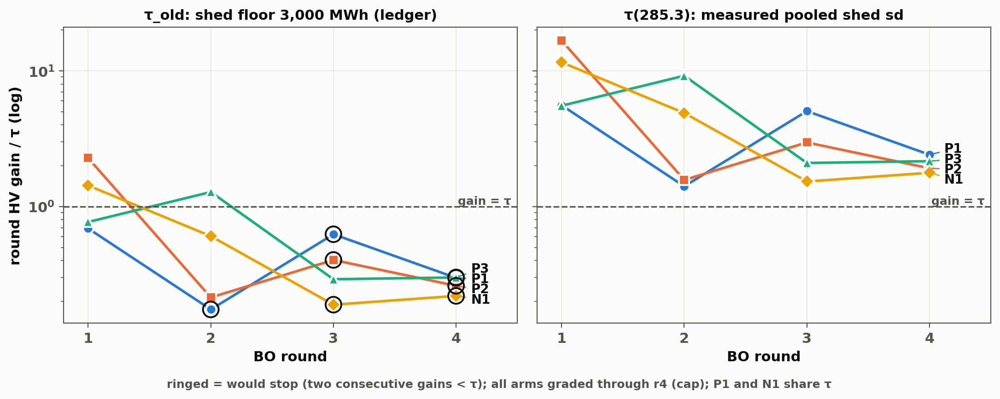

# Stop rule under the measured noise: τ re-derivation and regrade (prompt 45)

Branch `phaseb`, 2026-10-25. Zero simulation. Env `bogp-botorch`, bo-gp
`60e6328`. Data: d6 `b0a6e1e` (10-23 final gradings), synced in commit
`4908ae9` before any analysis. Scripts in this directory:
- `part_c45.py`: a copy of `noise_floor/part_c.py` with a provenance
  header. Only the outputs and the noise set changed.
- `rider45.py`
- `make_fig45.py`

Outputs: `tau_regrade45.csv`, `tau_regrade45.json`, `rider45.json`,
`fig_tau_regrade45.png/.pdf`.

## 1. Framing

- **Campaign verdicts STAND** as pre-registered under τ_old. All results
  below are a re-grade for reporting, and nothing in the ledgers changes.
- **The scalar framing is rejected.** The pinned rejection trigger fired in
  REPLICATE_RESULT (rep41 `f3aad22`).
  - 285.3 MWh is used below only as a LABELED campaign-level scalar.
  - It is the pooled sd, dominated by the HIGH design (Satterthwaite ν ≈ 3).
  - Per-design sds are 0 / 13.34 / 520.1.
  - Its direction is conservative for the headline: it overstates the
    honest heteroscedastic τ (§2), and even so it produces no stop.
- **The heteroscedastic row (Phase-B form (ii)) is the primary for the
  τ-setting recommendation** in the paper.

Pinned methods-paper sentence (verbatim; see the §5 caveat):

> "The stop threshold was derived from an assumed shed noise floor
> (3,000 MWh) that direct measurement later showed to be 3–19× the
> per-design noise (pooled 285.3, CI [162, 1057]; per-design
> 0/13.34/520.1); re-graded under the measured noise, no arm stops
> within the cap, so the recorded stops are early relative to the
> measured bar — a τ-calibration finding, not a failure of the
> two-strike rule — and we report all verdicts under both thresholds."

**Do NOT present the gains of rounds run after a recorded stop as
convergence evidence.** They are below τ_old, but under τ(285.3) the same
gains are 1.8–5.1× the threshold:

| Round | gain / τ(285.3) |
|---|---|
| P1 r3 | 5.05 |
| P1 r4 | 2.41 |
| P2 r4 | 1.92 |
| N1 r4 | 1.78 |

Every recorded stop round is also above 1 under τ(285.3): P1 r2 1.41,
P2 r3 2.97, P3 r4 2.16, N1 r3 1.53. The prompt's "≈1.5–4.9×" is the
τ(300) range from prompt 40 (part_c_regrade.csv). The values here are at
285.3.

## 2. τ per arm

τ is computed with the prompt-30 recipe:
- 1,000 MC draws, seed 20261006, all 32 starts perturbed.
- Curtailment 5,000 MWh and cost $0.5M stay fixed (only shed was measured).
- Exact HV at the ledger ref.
- N1 shares P1's starts and ref, so N1's τ equals P1's in every row.

τ in units of 10¹⁶ (τ / τ_old in brackets):

| τ row | shed noise (MWh) | P1 = N1 | P2 | P3 |
|---|---|---|---|---|
| τ_old (reproduce-check) | 3,000 | 5.263 (1) | 7.472 (1) | 7.123 (1) |
| **scalar (labeled, primary scalar)** | **285.3** | **0.651 (0.124)** | **1.017 (0.136)** | **0.991 (0.139)** |
| measurement CI low | 162 | 0.450 (0.086) | 0.792 (0.106) | 0.813 (0.114) |
| measurement CI high | 1,057 | 2.045 (0.389) | 2.833 (0.379) | 2.587 (0.363) |
| deployed GP inferred, n0 = 32 | 317 | 0.707 (0.134) | 1.084 (0.145) | 1.043 (0.146) |
| deployed GP inferred, n0 = 48 | 527 | 1.091 (0.207) | 1.559 (0.209) | 1.437 (0.202) |
| **heteroscedastic, form (ii)** | σ(y) per start | **0.302 (0.057)** | **0.660 (0.088)** | **0.695 (0.098)** |

(The deployed-GP value at n0 = 16, 332 MWh, exists, but neither tier uses
it, so it is not a row here.)

- **As % of HV₀:**

  | τ row | P1/N1 | P2 | P3 |
  |---|---|---|---|
  | τ_old | 7.97 % | 4.75 % | 4.56 % |
  | τ(285.3) | 0.99 % | 0.65 % | 0.63 % |
  | τ_het | 0.46 % | 0.42 % | 0.45 % |

- **τ_old is 7.2–8.1× τ(285.3)**, and 10–17× τ_het.
- **Heteroscedastic map** (PHASE_B.md §3): σ = 0 for y ≤ 429.5; slope
  0.0031444 on [429.5, 4,672]; slope 0.0152813 above (anchors
  0 / 13.34 / 520.1). It is applied to each start's observed shed.

  | Arm | starts with σ = 0 | starts with σ ≤ 13.34 | median σ | max σ |
  |---|---|---|---|---|
  | P1/N1 | 7 | 24 of 32 | 7.2 | 152 |
  | P2 | 11 | 22 of 32 | 4.7 | 295 |
  | P3 | 7 | 21 of 32 | 8.2 | 298 |

- **Expected ordering holds:** τ_het ≤ τ(285.3) for every arm. Most starts
  sit where σ ≈ 0–13, so the no-stop conclusion holds a fortiori.
- **Checks (all PASS):**
  - τ at 3,000 reproduces each ledger threshold to 1e-12.
  - HV₀ matches the ledger.
  - The two-strike regrade under τ_old reproduces every recorded
    would_stop, including P1's live-stop patch.
  - The vector (per-start) τ path at a constant 285.3 equals the scalar
    path bit-for-bit.
  - τ(300) equals part_c.json.
  - τ is monotone in the scalar shed noise for every arm.
  - The gains equal part_c_regrade.csv on all 14 overlapping rows.
  - All four ledgers are graded through r4.

## 3. Regrade: verdicts, old vs new (arm-labeled)

Two-strike rule: stop after round k when gain_k < τ and gain_{k−1} < τ.
Each cell is gain / τ; ✱ marks a would-stop.

| arm, round | τ_old | τ(285.3) | τ_het | CI 162 | CI 1,057 | GP 317 | GP 527 |
|---|---|---|---|---|---|---|---|
| P1 r1 | 0.69 | 5.58 | 12.01 | 8.07 | 1.78 | 5.13 | 3.33 |
| P1 r2 | 0.17 ✱ (live stop) | 1.41 | 3.04 | 2.04 | 0.45 | 1.30 | 0.84 |
| P1 r3 | 0.62 ✱ (overrun) | 5.05 | 10.89 | 7.31 | 1.61 | 4.65 | 3.01 |
| P1 r4 | 0.30 ✱ (overrun) | 2.41 | 5.20 | 3.49 | 0.77 | 2.22 | 1.44 |
| P2 r1 | 2.28 | 16.73 | 25.78 | 21.47 | 6.01 | 15.71 | 10.92 |
| P2 r2 | 0.21 | 1.57 | 2.42 | 2.02 | 0.56 | 1.48 | 1.03 |
| P2 r3 | 0.40 ✱ (stop) | 2.97 | 4.57 | 3.81 | 1.07 | 2.79 | 1.94 |
| P2 r4 | 0.26 ✱ (overrun) | 1.92 | 2.95 | 2.46 | 0.69 | 1.80 | 1.25 |
| P3 r1 | 0.77 | 5.54 | 7.89 | 6.74 | 2.12 | 5.26 | 3.82 |
| P3 r2 | 1.28 | 9.21 | 13.13 | 11.22 | 3.53 | 8.74 | 6.35 |
| P3 r3 | 0.29 | 2.10 | 2.99 | 2.55 | 0.80 | 1.99 | 1.44 |
| P3 r4 | 0.30 ✱ (stop, at cap) | 2.16 | 3.08 | 2.63 | **0.83 ✱** | 2.05 | 1.49 |
| N1 r1 | 1.43 | 11.56 | 24.91 | 16.72 | 3.68 | 10.65 | 6.90 |
| N1 r2 | 0.61 | 4.89 | 10.54 | 7.08 | 1.56 | 4.50 | 2.92 |
| N1 r3 | 0.19 ✱ (stop) | 1.53 | 3.30 | 2.21 | 0.49 | 1.41 | 0.91 |
| N1 r4 | 0.22 ✱ (overrun) | 1.78 | 3.83 | 2.57 | **0.57 ✱** | 1.64 | 1.06 |

Recorded stops under τ_old (the ledgers):

| Arm | Recorded stop | Overruns (gain / τ_old) |
|---|---|---|
| P1 | r2 (live) | r3 0.62, r4 0.30 |
| P2 | r3 | r4 0.26 |
| P3 | r4 (at cap) | none |
| N1 | r3 | r4 0.22 |

First would-stop round under each τ row:

| arm | τ_old | τ(285.3) | τ_het | CI 162 | CI 1,057 | GP 317 | GP 527 |
|---|---|---|---|---|---|---|---|
| P1 | r2 | none | none | none | none | none | none |
| P2 | r3 | none | none | none | none | none | none |
| P3 | r4 | none | none | none | **r4** | none | none |
| N1 | r3 | none | none | none | **r4** | none | none |

- **Consistency gate (§3.3): PASS.** No row stops under τ(285.3), so no
  row contradicts part_c's no-stop grading at 300.
- **NEW rows P2 r4 and P3 r4** (not in part_c_regrade.csv). These are
  FINDINGS:
  - **P2 r4** has gain/τ 1.92 at 285.3 and 0.69 at 1,057. Its two-strike
    pair is r3/r4. At 285.3, neither round is below τ. At 1,057, r3 is
    1.07 > 1, so there is **no stop** at either level.
  - **P3 r4** has gain/τ 2.16 at 285.3 and 0.83 at 1,057. Its two-strike
    pair is r3/r4. At 285.3, neither is below τ, so **no stop**. At 1,057,
    r3 0.80 and r4 0.83 are both below τ, so it **STOPS at r4**, the same
    round as its recorded τ_old stop.

## 4. Break-even shed floors

The break-even is the smallest shed floor at which each arm's FIRST
recorded stop still fires. It is found by bisection on [300, 3,000] with
the τ recipe.

| arm | first recorded stop | break-even shed floor (MWh) | vs measurement CI [162, 1,057] |
|---|---|---|---|
| P1 | r2 (live) | 1,997 | above the CI top |
| N1 | r3 | 1,726 | above the CI top |
| P2 | r3 | 1,133 | above the CI top |
| **P3** | **r4 (graded 10-23)** | **858** | **INSIDE the CI** |

- The three pinned values reproduce prompt 40 exactly
  (1,996.7 / 1,726.4 / 1,133.1). **All three sit above the CI top
  (1,057), so none of these three recorded stops survives anywhere in the
  measurement CI.**

## 5. Deviation (disclosed, not fixed): the pinned "citable fact" and sentence vs P3 r4

**The pinned fact does not hold for all four arms.** The prompt pins: "no
recorded stop survives anywhere in the measurement CI". That was written
against the three break-evens known before P2/P3 r4 were graded.
- **P3** has a recorded stop (r4, at cap) with a break-even of 858 MWh.
  That is inside the CI, so at the CI top (1,057) P3 still stops at r4.
- **N1** also stops at the CI top, at r4 instead of its recorded r3.
- **Correct wording** of the citable fact: "the three break-even floors
  that existed before the 10-23 gradings (P2 1,133 / N1 1,726 / P1 1,997)
  sit above the CI top; P3's r4 stop (break-even 858) survives at the CI
  top, and N1 stops one round late there."

**The pinned sentence holds only below the CI top.** Its clause "no arm
stops within the cap" holds:
- at the primary scalar 285.3;
- at the heteroscedastic τ;
- at CI-low 162;
- at the inferred 317 and 527.

It does NOT hold at the CI top 1,057. The sentence is quoted verbatim in
§1 as pinned. The strategy session decides whether to qualify it (for
example: "…no arm stops within the cap at the measured pooled value or
under the heteroscedastic noise model; at the upper CI limit, P3 and N1
stop at r4").

## 6. Baseline-rider re-run (prompt-34 §3.3)

**Original old-floor rider (verbatim, RANDOM_BASELINE.md):** "**Not robust
to floor-level output perturbation** (§3.3: 47 % of 1,000 perturbed draws
keep the point row "above"; threshold 80 %)."

**Measured-shed re-run of the prompt-34 rider.**
- Machinery: `rb_hv.py`, imported and unmodified. The perturb function is
  copied with the floors passed in; nothing else differs.
- Settings: 1,000 draws, seed `default_rng([20261006, d])`, 2,000 subsets
  per draw, R_frozen, deterministic point row "above" (p̂48 = 0.942).
- Noise levels: shed at the measured **285.3 MWh**. Curtailment 5,000 MWh
  and cost $0.5M stay at their ASSUMED floors, because only shed was
  measured.
- Step 1, the reproduce check: the old floors give
  above 467 / comparable 531 / matched 2, the same p̂ p5/p50/p95
  (0.32 / 0.87 / 1.00), and the same BO HV/HV₀ quantiles, all exact.

| perturbation | above | comparable | matched | fraction "above" | verdict (threshold 0.80) | p̂48 p5 / p50 / p95 | BO HV/HV₀ p5 / p50 / p95 |
|---|---|---|---|---|---|---|---|
| old floors 3,000 / 5,000 / $0.5M (recorded) | 467 | 531 | 2 | 0.467 | not robust | 0.32 / 0.87 / 1.00 | 1.042 / 1.091 / 1.248 |
| **measured shed 285.3 / 5,000 / $0.5M** | **632** | **368** | **0** | **0.632** | **not robust** | 0.75 / 0.93 / 1.00 | 1.059 / 1.071 / 1.091 |

**Result:** at the measured shed noise, 63.2 % of draws keep the point row
"above". That is up from 46.7 %, but still below the 80 % threshold, so
**the "not robust" rider stays**.
- The remaining instability comes from the curtailment and cost
  perturbations, which are still at their assumed, unmeasured floors.
- With the measured shed noise, the BO HV/HV₀ upper tail narrows from
  1.248 to 1.091.
- No draw now reaches "matched".

Numbers: `rider45.json`.

## 7. Not analyzed here

The prompt-37 truth-known stop-rule suite landed on branch `stoprule`
around 10-13 and has never been analyzed. That is a pre-existing
follow-up and is NOT analyzed here.

The figure shows gain/τ per round:
- Left panel: τ_old. Right panel: τ(285.3).
- Rings mark would-stop rounds.
- The other τ rows are in the tables above.
- Every plotted value is asserted against `tau_regrade45.csv` /
  `tau_regrade45.json` before drawing.
