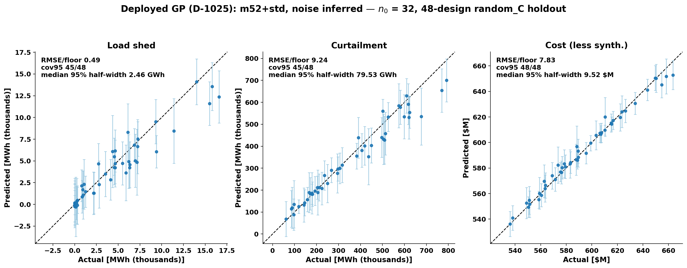
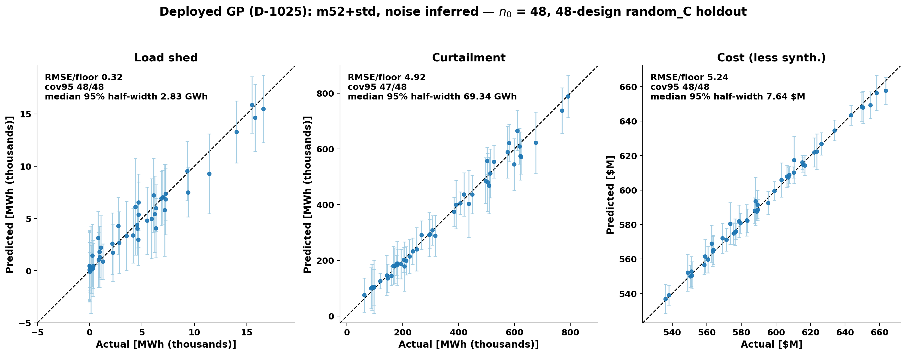

# GP status: the deployed GP at n0 = 32 and 48 (prompt 47)

1. **Config:** the deployed GP is m52 + std with the noise inferred (floor
   lifted).
2. **Fit definition:** it uses the campaign fit definition. The data are
   scored on the 48-design `random_C` holdout as a deterministic replay of
   the recorded scorings; no new model–holdout pair is scored.
3. **Use of each tier:**
   - n0 = 32 is the BO navigation tier.
   - n0 = 48 is the accuracy tier, for grading and the final surrogate
     (NXT-D10 rider).
4. **Decision record:** D-1025 in pi-agenda, together with its riding
   disclosures.

| objective | n0 | RMSE (raw) | RMSE / assumed floor (shed 3,000 MWh / curt 5,000 MWh / cost $0.5M) | cov95 / 48 | inferred noise sd (raw) | median 95% half-width (raw) | latent share (median latent sd / total sd) |
|---|---|---|---|---|---|---|---|
| shed | 32 | 1,483 MWh | 0.494 | 45 | 317 MWh | 2,464 MWh | 0.968 |
| shed | 48 | 974 MWh | 0.325 | 48 | 527 MWh | 2,831 MWh | 0.931 |
| curt | 32 | 46,224 MWh | 9.245 | 45 | 9,035 MWh | 79,531 MWh | 0.975 |
| curt | 48 | 24,585 MWh | 4.917 | 47 | 8,530 MWh | 69,340 MWh | 0.970 |
| cost | 32 | $3.915M | 7.830 | 48 | $1.179M | $9.519M | 0.970 |
| cost | 48 | $2.622M | 5.244 | 48 | $1.092M | $7.637M | 0.960 |

**Shed: cross-reference to the measured noise.** The scalar framing is
rejected.

| Measure | Value (MWh) |
|---|---|
| Pooled sd | 285.3, CI [162, 1,057] |
| Per-design sd (LOW / MID / HIGH) | 0 / 13.34 / 520.1 |

Footnote: the latent share decomposes the band against the model's own
fitted noise estimate, not the measured noise; per-design the model
overstates LOW/MID noise (true ~0–13) and roughly matches HIGH (527 vs
520) — 'validated' is a scalar-range statement, not per-level calibration.

## Reproduction and new reference values

- **Script:** `make_gp_status47.py` is a copy of
  `bo_1025/make_fig_deployed_gp.py` with the arm loop restructured into a
  per-n0 figure function.
  - Kept unchanged: DEFAULT_CFG, FLOORS, the 1e-9 free-noise constant,
    `torch.manual_seed(0)` before every FlexGP call, and `common.metrics`.
  - Each fit is re-seeded independently, so loop order does not affect the
    result.
  - Env: `bogp-botorch`, 4 threads.
- **Fits:** all three n0 are fitted; only n0 = 32 and 48 are plotted.
- **Recorded numbers** (`bo_1025/SLIDE_TEXT_1025.md`, n0 = 16 / 32 / 48):
  ALL MATCH.

  | Quantity | Recorded |
  |---|---|
  | shed RMSE/floor | 0.582 / 0.494 / 0.325 |
  | cov95 shed | 45 / 45 / 48 |
  | cov95 curt | 44 / 45 / 47 |
  | cov95 cost | 48 / 48 / 48 |
  | inferred shed noise | 332 / 317 / 527 |

- **New reference:** curt and cost RMSE/floor had no text record before.
  These values are now the reference:

  | Objective | n0 = 16 | n0 = 32 | n0 = 48 |
  |---|---|---|---|
  | curt | 17.348 | 9.245 | 4.917 |
  | cost | 15.292 | 7.830 | 5.244 |

- **The n0 = 16 values (printed by the script, not tabulated above):**

  | Objective | RMSE | inferred noise | median half-width | latent share |
  |---|---|---|---|---|
  | shed | 1,747 | 332 | 3,602 | 0.984 |
  | curt | 86,738 | 12,527 | 117,274 | 0.978 |
  | cost | $7.646M | $1.794M | $16.020M | 0.976 |

- **Latent sd:** the bo_1021 convention, using `latent_sd_t` from the
  floor40 `noise_floor/provisional/sweep_converged.py`. It is inlined with a
  provenance comment, not imported.
- **Deviation (disclosed):** the source script also ran a floored companion
  fit, only to print its noise beside the free fit. That fit is dropped
  here. It never entered a plotted or recorded number.
