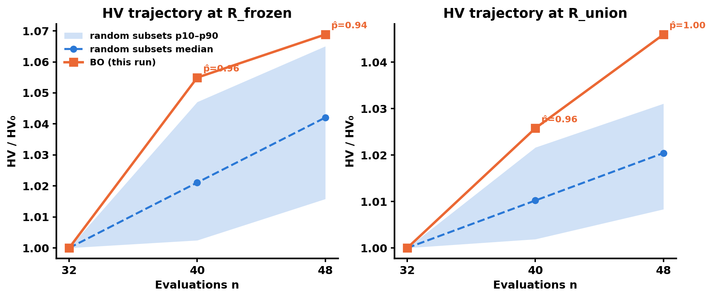
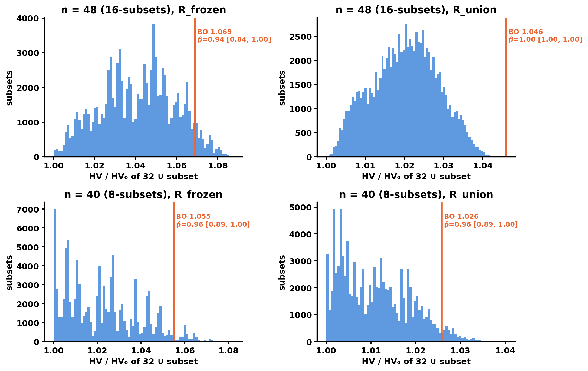
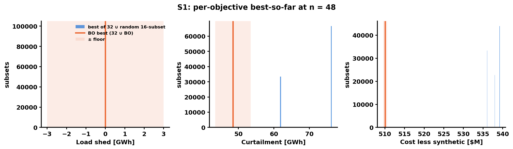
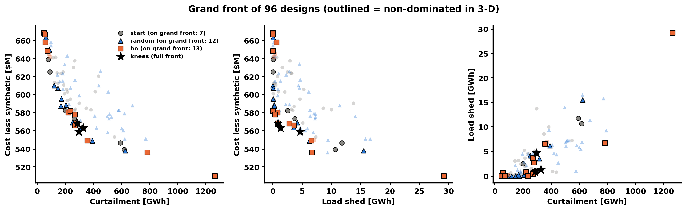

# Stage-2 random baseline: 48 uniform random designs vs the BO campaign (prompt 34, scenario C)

**Verdict (pre-registered §3.2 wording, both refs):** BO's HV is above most
random 16-design batches at this budget (estimated percentile 0.94, interval
[0.84, 1.00]) at R_frozen; at R_union: percentile 1.00, interval [1.00, 1.00].
**Not robust to floor-level output perturbation** (§3.3: 47 % of 1,000
perturbed draws keep the point row "above"; threshold 80 %).

BO's total HV gain (6.9 % of HV₀) is below the campaign's per-round noise bar
(8 %). No HV result in this experiment can show BO ahead by more than that bar.

**Scope.** BO is one realization (one acquisition seed). This places THIS run
within the distribution of random 16-design batches drawn from one pool of 48.
It does not estimate q-ParEGO's seed-averaged performance; method-level
evidence stays on the Stage-1 replay.

Executed record: `random_baseline.ipynb`. Numbers: `t2_summary.json`. Union
ref: `ref_union.json`. Data: `waves/random_C` (48/48, collector `ce16936`)
plus the frozen 32 starts and `bo_C_r1` / `bo_C_r2`. HV =
`bogp.mobo.pareto.hypervolume_exact` (bo-gp `60e6328`, asserted equal to
`ledger['bo_gp_sha']`) on raw units. Costs are g1-pending; option (c) adds a
constant to every design, so nothing here depends on g1.

## Plain summary for Kay

1. Against 100,000 random 16-design batches from the 48-design pool, BO's
   HV is higher than 94 % of them at the frozen box and 100 % at the
   union box, so the pre-registered row is "above" at both refs.
2. That lead is small in absolute terms: +0.027 HV₀ over the median random
   batch at the frozen box. With floor-sized noise on the outputs, the
   percentile drops below 0.90 in 53 % of draws, so the verdict carries
   "not robust".
3. The clearer separation is at the extremes. BO's cheapest design ($510.1M)
   and its lowest-curtailment design (48.4 GWh) are better than every one of
   the 48 random designs by more than the floor ($26M and 13 GWh better).
   No random batch came within a floor of either.
4. No random design dominates any BO design, and 13 of BO's 16 picks are on
   the 96-design grand front, against 12 of the 48 random designs.
5. The recipe did not fully survive the extra data: the top knee of the
   96-design front is a random design at 1.49 GW, below the 1.6 GW floor,
   and two clipped-front knees break the wind_122 and/or total-MW limits.
   Nuclear at its 0.05 floor and a wind_303/317 share ≥ 0.5 hold in all six
   knees.
6. This is one BO run; a second BO seed is the next test of whether the
   result holds.

## 1. Inputs and gates

| Gate | Result |
|---|---|
| bo-gp HEAD == ledger `bo_gp_sha` | `60e6328` ✓ |
| BO HV at n = 32 / 40 / 48 vs ledger | rel. error 0.0 / 0.0 / 0.0 (gate 1e-9) ✓ |
| random_C rows | 48, indices 1..48, finite M, no `FAILED_random_C.md` ✓ |
| Overlap with the 48 evaluated designs | 0 (lattice-index keys) ✓ |
| HV rate | 0.454 ms/call (prompt measured 0.45); 12 worker processes |

**Refs.**

| Objective | R_frozen (ledger) | R_union (frozen formula) |
|---|---|---|
| load_shed_mwh | 15,102 | 32,100 |
| true_curtailment_mwh | 670,350 | 1,385,278 |
| total_cost_less_synthetic_usd | 652.03 M | 684.32 M |

R_union = nadir + 0.1·span over all 96 evaluated designs. It is computed once
and persisted to `ref_union.json`. **It equals BO_STAGE2's REF48 exactly.**
On every objective, the random designs fall inside the min–max span of the
48 evaluated designs. The R_union rows are therefore also the continuity
values for BO_STAGE2's wider-box control: BO at REF48 is 1.0258 at n = 40
and 1.0460 at n = 48, with gains of +2.58 % and +2.02 %.

## 2. Primary statistic (§3.1)

The pool is one i.i.d. set of 48; `arm` never enters this computation (test
`test_primary_ignores_arm`).
- Subsets: 100,000, seed 20261012, paired across the two refs.
- Interval: 1,000 pool bootstraps × 2,000 subsets, 5th–95th percentile.
- Ties: within 1e-12 relative, counted ½.

| Ref | n | BO HV/HV₀ | random p10 / p50 / p90 | BO − median [HV₀] | p̂ | interval | §3.2 row |
|---|---|---|---|---|---|---|---|
| R_frozen | 40 | 1.0549 | 1.0025 / 1.0211 / 1.0471 | +0.034 | 0.962 | [0.887, 1.000] | above |
| R_frozen | **48** | **1.0688** | 1.0158 / 1.0421 / 1.0651 | **+0.027** | **0.942** | **[0.836, 1.000]** | **above** |
| R_union | 40 | 1.0258 | 1.0019 / 1.0102 / 1.0216 | +0.016 | 0.959 | [0.889, 1.000] | above |
| R_union | **48** | **1.0460** | 1.0083 / 1.0204 / 1.0311 | **+0.026** | **1.000** | **[1.000, 1.000]** | **above** |

- At R_union, none of the 100,000 subsets reaches BO. The bootstrap
  interval collapses to [1, 1] because no resampled pool contains a subset
  that does either. That is a statement about this pool, not certainty about
  random sampling. A finite pool of 48 slightly understates the variance of
  random sampling from the full lattice.
- The p10 at n = 48 is 1.016 / 1.008, not exactly 1.000. HV is monotone, so
  the floor for any subset is 1.000.

**Provenance only** (3 draw blocks of 16; under the null, BO ranks first 1
time in 4):

| Ref | BO n=48 | arm 1 | arm 2 | arm 3 | BO rank | whole 48-pool (n = 80) |
|---|---|---|---|---|---|---|
| R_frozen | 1.0688 | 1.0581 | 1.0376 | 1.0293 | 1 / 4 | 1.0885 |
| R_union | 1.0460 | 1.0238 | 1.0202 | 1.0193 | 1 / 4 | 1.0446 |

Using all 48 random designs at once (n = 80) gives 1.0885 at R_frozen, above
BO's 1.0688 with 16 designs. At R_union it gives 1.0446, **below** BO's
1.0460 with 16. This is descriptive only.

Rows 1–8 of each arm at n = 40 are one arbitrary 8-subset each, so these
values are illustrative only:

| Ref | Arm 1 | Arm 2 | Arm 3 | BO |
|---|---|---|---|---|
| R_frozen | 1.0456 | 1.0003 | 1.0069 | 1.0549 |
| R_union | 1.0182 | 1.0031 | 1.0019 | 1.0258 |

## 3. Robustness: paired floor perturbation (§3.3, report-only)

**Method.**
- 1,000 draws, seed 20261006.
- Each draw adds N(0, floor²) noise to every evaluated point, with floors
  3,000 MWh, 5,000 MWh and $0.5M. The 32 starts get one common perturbation.
- R_frozen stays fixed; HV₀ is recomputed from the perturbed starts.
- In each draw, p̂48 is computed from 2,000 subsets, and only its point row
  is recorded.

**Results.**

| Point row | Draws |
|---|---|
| above (p̂ ≥ 0.90) | 467 |
| comparable | 531 |
| matched (p̂ ≤ 0.10) | 2 |

- **Fraction matching the deterministic row ("above"): 0.467 < 0.8.** The
  headline therefore carries "not robust to floor-level output
  perturbation".
- Perturbed p̂48: p5 / p50 / p95 = 0.32 / 0.87 / 1.00.
- BO HV/HV₀ under perturbation: p5 / p50 / p95 = 1.042 / 1.091 / 1.248.
  The wide upper tail comes from points crossing the fixed box boundary.

## 4. Pre-registered secondaries (§3.4)

*These are descriptive, with no multiplicity correction, and are not used in
the verdict.*

### 4.1 n = 40 percentile

p̂40 = 0.962 [0.887, 1.000] at R_frozen and 0.959 [0.889, 1.000] at
R_union. That is the "above" row at both refs, the same row as n = 48.

### 4.2 S1: extremes attainment

**Matching rule.** BO's best is taken over 32 starts ∪ BO. The random
counterpart is the best over 32 starts ∪ a random 16-subset, using the same
100,000 subsets as §2.

| Objective | BO best (from) | Best in 32 starts | Best in 48-pool (from) | P(subset best ≤ BO − floor) | P(subset best ≥ BO + floor) | BO beats pool by > floor |
|---|---|---|---|---|---|---|
| Shed [MWh] | 0 (n0b#10, r1#5, r2#2, r2#6) | 0 | 0 (rnd#9 and others) | 0.00 | 0.00 | no (tie at 0) |
| Curtailment [MWh] | 48,444 (r1#5) | 76,269 | 61,739 (rnd#15) | 0.00 | 1.00 | **yes** (−13,295) |
| Cost less synthetic [$M] | 510.07 (r2#3) | 539.25 | 536.00 (rnd#42) | 0.00 | 1.00 | **yes** (−25.9) |

- **BO's best beats the pool's best by more than the floor on 2 of 3
  objectives**, whether the pool is taken alone or with the starts.
- No random 16-batch came within a floor of BO's curtailment or cost
  extreme.
- *Caveat: the cost extreme is guessable from physics (minimum build); S1
  compares BO with uniform random, not with a domain heuristic.*

### 4.3 S2: grand front and recipe robustness

**(i) Grand front of all 96 designs: 32 designs.**

| Source | On the grand front | Fraction |
|---|---|---|
| BO | 13 of 16 | 0.81 |
| Random | 12 of 48 | 0.25 |
| Starts | 7 of 32 | — |

**(ii) Subset-matched counts** (first 20,000 of the §2 16-subsets):

| Front | Random 16-subset on it, mean (p10–p90) | BO on it |
|---|---|---|
| 32 ∪ BO ∪ subset | 5.0 (3–7) | 13.0 of 16 |
| 32 ∪ subset (like-for-like with BO's 13 on 32 ∪ BO) | 6.6 (5–8) | — |

**(iii) Recipe R** (frozen pre-submission). R requires all four:
- nuclear ω = 0.05;
- total MW in [1.6, 2.0] GW;
- (wind_303 + wind_317) / total ≥ 0.5;
- wind_122 ω ≤ 0.2875.

The top 3 utopia-distance knees of the 96-point front, under both BO_STAGE2
§1 normalizations:

| Normalization | Knee | Source | nuclear | pv | tail | wind_122 | wind_303 | wind_317 | total MW | wind share | in R |
|---|---|---|---|---|---|---|---|---|---|---|---|
| full front (32) | **rnd#2** | random | 0.05 | 0.762 | 0.169 | 0.169 | 0.406 | 0.881 | **1,491** | 0.70 | **no** |
| full front (32) | n0b#8 | start | 0.05 | 0.05 | 0.762 | 0.169 | 0.762 | 0.881 | 1,699 | 0.79 | yes |
| full front (32) | r1#2 | BO | 0.05 | 0.288 | 0.881 | 0.288 | 0.762 | 0.644 | 1,705 | 0.68 | yes |
| clipped to R_frozen (25) | **r2#1** | BO | 0.05 | 0.525 | 0.762 | **0.525** | 0.644 | 0.644 | 1,825 | 0.58 | **no** |
| clipped to R_frozen (25) | **rnd#43** | random | 0.05 | 0.881 | 0.644 | **0.644** | 0.406 | 1.000 | **2,084** | 0.55 | **no** |
| clipped to R_frozen (25) | r1#2 | BO | 0.05 | 0.288 | 0.881 | 0.288 | 0.762 | 0.644 | 1,705 | 0.68 | yes |

**Not every knee of the 96-point front is in R. There are three recipe
counter-examples:**

| Knee | Normalization | Why it is outside R |
|---|---|---|
| rnd#2 | full front, the top knee | total 1,491 MW, below the 1.6 GW floor |
| r2#1 | clipped front | wind_122 ω 0.525, above 0.2875 |
| rnd#43 | clipped front | total 2,084 MW, above 2.0 GW; wind_122 ω 0.644 |

- r2#1 was already a clipped-front knee in BO_STAGE2 at n = 48. R was
  checked before submission against the three full-front knees only, so r2#1
  was outside R from the start.
- **What holds across all six knees:** nuclear ω = 0.05, and a
  wind_303 + wind_317 share ≥ 0.5 (range 0.55–0.79).
- **What does not hold:** the [1.6, 2.0] GW total band (the knees span
  1.49–2.08 GW) and the wind_122 cap.
- r1#2 is a knee in every normalization at both n = 48 and n = 96.

### 4.4 Set coverage

C(A, B) is the fraction of B weakly dominated by some member of A:

| A ↓ / B → | BO | arm 1 | arm 2 | arm 3 |
|---|---|---|---|---|
| BO | 1.00 | 0.56 | 0.56 | 0.38 |
| arm 1 | **0.00** | 1.00 | 0.62 | 0.50 |
| arm 2 | **0.00** | 0.38 | 1.00 | 0.31 |
| arm 3 | **0.00** | 0.31 | 0.69 | 1.00 |

- No random design weakly dominates any BO design.
- Count of each set's 16 on the front of 32 ∪ set: BO 13, arm 1 8, arm 2 6,
  arm 3 7.

### 4.5 Per-objective best-so-far

| | n = 32 | n = 40 | n = 48 |
|---|---|---|---|
| BO: shed / curt [MWh] / cost [$M] | 0 / 76,269 / 539.3 | 0 / 48,444 / 539.3 | 0 / 48,444 / 510.1 |
| arm 1 (rows in order) | 0 / 76,269 / 539.3 | 0 / 76,269 / 539.3 | 0 / 61,739 / 539.3 |
| arm 2 | 0 / 76,269 / 539.3 | 0 / 76,269 / 538.0 | 0 / 76,269 / 538.0 |
| arm 3 | 0 / 76,269 / 539.3 | 0 / 76,269 / 539.3 | 0 / 76,269 / 536.0 |
| random subset median | 0 / 76,269 / 539.3 | 0 / 76,269 / 539.3 | 0 / 76,269 / 538.0 |

## 5. Expectations were stated beforehand

Prompt 34 §0.1, written before submission, to be sent to Kay and the PI:

> "The most likely result is 'comparable'. BO's total HV gain was 6.9 % of
> the starting HV, which is below our own 8 % per-round noise bar. In
> Stage 1 at scenario C, BO led random by only a few evaluations. In a
> dense front, a random design often lands on the front and earns about
> as much HV as a BO design. Also, the fixed HV box gives zero credit to
> 5 of BO's 16 picks. A 'comparable' HV result is a finding about this
> regime, not a failure. The test that can separate the methods is S1
> (extremes): BO went to the corners, and uniform random sampling rarely
> reaches a corner. The paper's recipe and automation claims do not
> depend on BO beating random. The random pool also tests whether the
> recipe still holds with more data."

**Against the expectation:**
- The deterministic row came out "above", not the expected "comparable".
  Under floor-level perturbation, though, 53 % of draws fall in
  "comparable", so the expectation is not far off.
- The S1 prediction held: BO reached two corners that no random batch
  reached.
- The recipe test returned counter-examples (§4.3 iii).

## 6. Compute

- 48 runs, about 15 core-h per run, about 715 core-h.
- Array 1526985 and collector 1526986. All 48 tasks were clean; the
  collector committed the results (`ce16936`).
- T2 ran locally: about 10 min on 12 processes, about 10.4 M HV calls.
