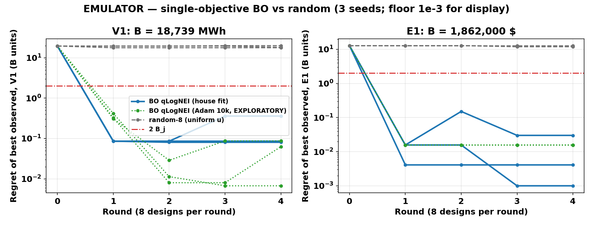
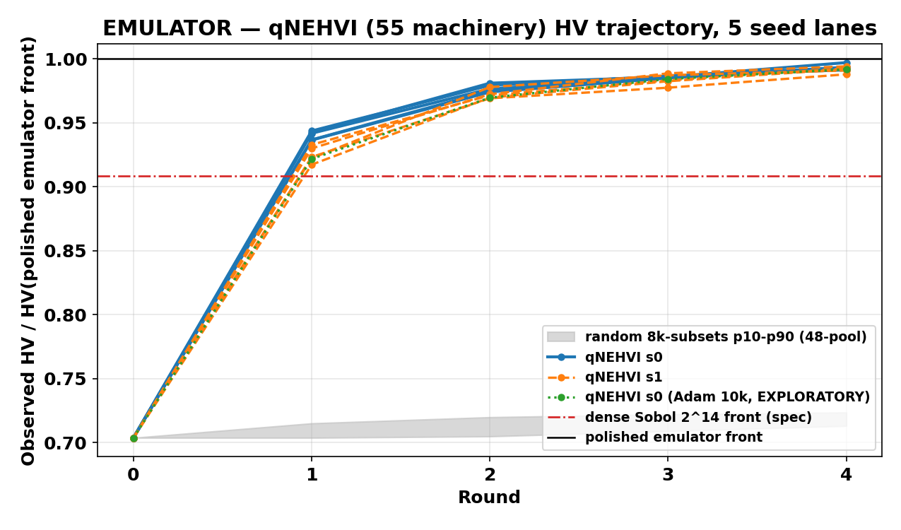
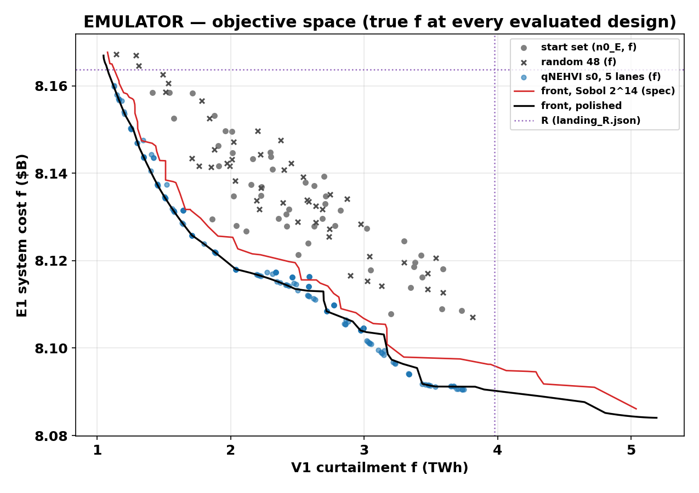
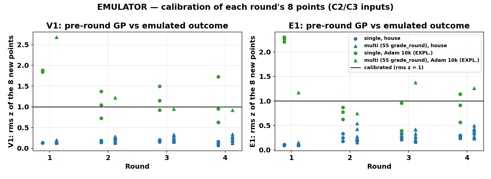

# EMULATOR BO dry run on the committed GPs (prompt 66 v1, 2026-11-24)

**EMULATOR. This is a machinery check, not a result.** No PCM ran. No CRC job ran.
Nothing here goes into a ledger, the plan, a decision row or the paper's claims.
Every number below comes from an emulator built from the 54 committed GPs.
"Truth" in this file means the emulator's truth, not the ERCOT system.

Branch `ercot/66-emulator-bo`, rebased on `ercot/tx123` = 93c81a4 (work done on b23021c;
93c81a4 adds only plan AMENDMENT 2026-11-24b). **That amendment replaces the house GP fit (Adam 700)
with fit definition v2 (MAP, L-BFGS-B, 16 restarts) for every fit from now on.** This dry run uses the
committed configs as they stand (house fit) for both the emulator truth and the BO's GP; section 5's
10,000-epoch fit is the nearest proxy for a converged fit. Rerun after the v2 refit lands. Environment
bogp-botorch (botorch 0.16.1, torch 2.12.0, gpytorch 1.15.2). bo-gp-qparego
60e6328 (= `bogp_sha_expected`). Outputs: `analysis/emulator_E/` only, plus the
two disclosed `analysis/methods_E/` commits (section 7).

## 0. Verdict

| # | check (prompt 66 pass criteria) | result | pass |
|---|---|---|---|
| 1 | No crash: 12 single-objective house runs and 15 multi-objective house lanes finish; each lane ends where its scenario says | 12/12, 15/15, ends as expected | **PASS after a 55 fix.** As built, the multi-seed init CRASHED at seed 1 (section 7, change 3) |
| 2 | C1 ingest passes on every emulated round (55 `ingest_gate`) | 49/49 rounds | PASS |
| 3 | C2/C3 flag counts at or below nominal (Poisson 95 % limit of the expected count) | C2 0, C3 0 in 114 (round, objective) cells; expected C2 0.042 | PASS (see the power caveat, section 4.3) |
| 4 | Single-objective BO within 2 B_j of the emulator optimum by round 4 on >= 2 of 3 seeds | V1 3/3, E1 3/3 | PASS |
| 5 | Single-objective BO beats random-8 at matched budget (round 4, 80 evaluations) on every objective | V1 0.18 B vs 18.7 B; E1 0.011 B vs 12.3 B; every seed | PASS |
| 6 | Multi s0 (clean): 4 rounds, monitor mode, no halt, 5 lanes | yes | PASS |
| 7 | Multi s1 (one shed violation in r1): mode flips at r1; r2-r4 constrained qNEHVI with the shed GP; the violating run is out of HV (n_hv 55/63/71/79); 5 lanes | yes | PASS |
| 8 | Multi s2 (two violations in r1): `HALT_FOR_DECISION.md` written; `propose --round 2` refused; 5 lanes | yes | PASS |
| 9 | tau_exact = 0 -> budget-cap-only: gain/tau_exact null, would_stop never fires, every lane runs to the cap | yes | PASS |
| 10 | R2 and N1_off monitors at base + chatter raise no flag | R2 max 210.5 MWh (< 312.16); N1_off max 30,954 (dN1_off < 462.7) | PASS |
| 11 | HV fraction of the emulator front reported (no threshold) | s0 round 4, true f: 0.992-0.997 of the polished front | reported |

Three findings for the real campaign:

1. **55's init would have crashed on the real start set.** qNEHVI puts most r1
   designs on box vertices or faces. Four or five of the eight r1 designs are the
   same in every seed lane. 55 asserted pairwise-disjoint r1 sets. The prompt-55
   text asks only that the sets DIFFER. I relaxed the assert to the pinned text and
   record the shared count (section 7). Kay: confirm or reject this change.
2. **The house GP fit (Adam 700) over-states the noise, so C2/C3 have almost no
   power.** The BO's refitted GP infers noise sd 19.7k MWh (V1) and 0.93 $M (E1).
   The emulated chatter is 3.3k MWh and 0.40 $M. The rms z of every new batch is
   0.1-0.5, and every batch has 8/8 inside its 95 % band. An under-covering
   model cannot appear. With the 10,000-epoch fit (EXPLORATORY) the inferred
   noise falls to near the chatter (3.2k MWh, 0.29 $M), rms z is near 1, and C2
   fires in round 1 on 3 of 6 single-objective runs (section 5).
3. **The spec's dense-Sobol front is a weak reference.** The emulator optima sit
   on box vertices. 2^14 Sobol points miss them. The BO front beats the Sobol
   front (true-f HV fraction 1.09-1.10). I report the fraction against a
   polished front (Sobol + 64 vertices + 98 L-BFGS scalarizations) as the
   headline: 0.990-0.997 at round 4.

## 1. Emulator (prompt 66 §1)

- Training rows: the n* = 48 grading rows of `n0_E` (Sobol 0-47), read by the
  real 54 loader `analysis.ercot_gp.ercot_gp_loader.load` with
  `waves/design_space_E_2026-11-24.json`. 0 refused, 0 SUSPECT, R1 max 0.
- Fit: `ercot_gp_status.fit` (D-1025 FlexGP, `bogp.train_gp` Adam 700 epochs,
  lr 0.01, float32, `torch.manual_seed(0)`), floor 0 -> inferred-only 1e-9.
  This is the code path 54 used for `committed_configs.json`.
- f_j(u) = the posterior mean, frozen in a float64 closed form
  (`emulator_E_params.json`). It matches FlexGP's mean on 1,024 Sobol points to
  17 MWh (V1, 9e-4 B), $403 (E1, 2e-4 B) and 0.003 (N4).
- The refit reproduces the committed hyperparameters to <= 3.1e-6 relative.

| id | role | arm | ARD lengthscales (u units; 110 / 140 / 146 / 163 / 270 / 274) | outputscale sd | noise sd | mean const (std) | f* (L-BFGS) at u* | f* (Sobol 2^14) |
|---|---|---|---|---|---|---|---|---|
| V1 | seated | rbf+std | 1.8501 / 1.9054 / 1.8491 / 1.9502 / 1.4780 / 1.2010 | 759,011 MWh | 17,368 MWh | 1.565 | 1,047,345 MWh at [1, 0.98, 1, 0.76, 1, 0.97] | 1,098,496 |
| E1 | seated | m52+std | 1.6064 / 1.8450 / 1.7461 / 1.8987 / 1.2859 / 0.9575 | $18.34M | $0.827M | -2.591 | $8,084.05M at [0, 0, 0, 0.15, 0, 0] | $8,088.26M |
| N4 | co-reported (logged only) | m52+std | 1.7693 / 1.9323 / 1.7497 / 1.9444 / 1.2956 / 1.1264 | 323.0 h | 14.35 h | 1.392 | 3,574 h | 3,636 |

Caution: f*(V1) = 1.047 TWh lies 0.36 TWh (19 B) below the lowest
observed V1 (1.409 TWh). The emulator extrapolates to the all-PEM corner. The
regrets below are measured against that extrapolation. They test the machinery,
not the ERCOT optimum.

- Observation: y = f(u) + eps, eps ~ N(0, Sigma_c[V1, E1]) from
  `analysis/noise_v3/ercot_noise_seed_sigma_c.csv` (prompt-63 Seed chatter,
  LW-shrunk): sd V1 3,275 MWh, sd E1 $0.398M, corr 0.205.
- Streams: numpy `default_rng([6666, family, seed_id, scenario, variant])`.
  BO and its random baseline share one stream (common random numbers).
- Start set: the 48 n0_E designs with EMULATED values f(u_i) + eps_i
  (`default_rng(6666)`, first 48 x 2 draw). Every Y the BO sees comes from one
  generating process. The real n0_E Y are not used as observations.
- Guardrails: R1 = 0 (except injected rows), R2 = 156.08 + N(0, 18.8^2) MWh,
  N1_off = 30,750 + N(0, 52.3^2) line-h (sd of eps_N1 - eps_N4 from Sigma_c),
  N4 = f_N4 + N(0, 10.9^2) on an independent monitor stream.
- R (`waves/n0_E/landing_R.json`): V1 3,977,491 MWh, E1 $8,163.73M.
  B_V1 18,739 MWh, B_E1 $1.862M.

## 2. Single-objective BO (prompt 66 §2)

Settings: botorch `qLogNoisyExpectedImprovement`, `SobolQMCNormalSampler(128,
seed s)`, `prune_baseline`, `cache_root`, `optimize_acqf` over [0, 1]^6, q 8,
20 restarts x 512 raw samples, sequential. s = 20261007 + 100 seed_id + k
(seed_ids 0, 1, 2; `torch.manual_seed(s)` per round). GP = 55's `qnehvi_E.ObjGP`
(float64 SingleTaskGP, `bogp.train_gp` Adam 700) with the committed kernel and
transform and floor 1e-9, refitted on start + all rounds each round. Random
baseline = 8 i.i.d. uniform u per round from `default_rng(s)`, same s, same
noise stream. Regret = f(best-observed design) - f*, in B_j units.

| obj | method | seed | r0 | r1 | r2 | r3 | r4 | posterior-mean optimum r4 | cov95 r1-r4 | rms z r1-r4 | lengthscale drift r4 vs r0 |
|---|---|---|---|---|---|---|---|---|---|---|---|
| V1 | BO | 0 | 19.58 | 0.086 | 0.081 | 0.081 | 0.081 | 0.027 | 8/8/8/8 | 0.13/0.16/0.16/0.12 | 0.10 |
| V1 | BO | 1 | 19.58 | 0.086 | 0.086 | 0.360 | 0.360 | 0.014 | 8/8/8/8 | 0.13/0.15/0.20/0.07 | 0.08 |
| V1 | BO | 2 | 19.58 | 0.086 | 0.086 | 0.086 | 0.086 | 0.026 | 8/8/8/8 | 0.14/0.19/0.20/0.16 | 0.08 |
| V1 | random | 0 | 19.58 | 19.58 | 19.58 | 20.05 | 20.05 | - | - | - | - |
| V1 | random | 1 | 19.58 | 19.58 | 19.58 | 19.58 | 18.20 | - | - | - | - |
| V1 | random | 2 | 19.58 | 17.82 | 17.82 | 17.82 | 17.82 | - | - | - | - |
| E1 | BO | 0 | 12.80 | 0.004 | 0.004 | 0.004 | 0.004 | 0.011 | 8/8/8/8 | 0.11/0.33/0.26/0.30 | 0.05 |
| E1 | BO | 1 | 12.80 | 0.016 | 0.016 | 0.000 | 0.000 | 0.016 | 8/8/8/8 | 0.11/0.25/0.21/0.28 | 0.05 |
| E1 | BO | 2 | 12.80 | 0.016 | 0.151 | 0.030 | 0.030 | 0.010 | 8/8/8/8 | 0.09/0.17/0.32/0.24 | 0.07 |
| E1 | random | 0 | 12.80 | 12.66 | 12.66 | 12.66 | 12.66 | - | - | - | - |
| E1 | random | 1 | 12.80 | 12.80 | 12.80 | 11.91 | 11.91 | - | - | - | - |
| E1 | random | 2 | 12.80 | 12.80 | 12.80 | 12.31 | 12.31 | - | - | - | - |

Reading: the best observed can get worse (V1 seed 1, r3; E1 seed 2, r2). A
noisy low observation at a slightly worse design replaces the best. The
posterior-mean optimum is stable (0.01-0.03 B). BO reaches < 0.4 B in round 1
because both optima sit on box vertices, and `optimize_acqf` finds vertices
easily. Random-8 cannot reach the vertex region in 32 draws.

## 3. Multi-objective, 55 machinery (prompt 66 §3)

`acquire_E.Lane` + `cmd_init` + `propose_round` + `ingest_gate` (C1) +
`grade_round`, unchanged except section 7. Root = `analysis/emulator_E/`: waves
`analysis/emulator_E/waves/methods_E_EMU_<variant>_<scen>_s<seed>_r<k>/`
(design_matrix, retrofit dicts, predictions, manifest, README from the 55 wave
writer, plus `objectives_EMULATOR.csv`); ledgers
`analysis/emulator_E/lanes/<variant>/<scen>/s<seed>/`. Config = `arms_E.json`
(updated, section 7) with absolute paths, `part = "EMULATOR"`,
`n0_tier_provisional = 48`, wave/lane patterns renamed. Loader = the real 54
loader for n0_E (keys, U, meta, identity gate) with Y replaced by the emulated
start values, plus the emulated wave tables. qNEHVI block as pinned (alpha 0,
prune_baseline, Sobol 128, 20 x 512, q 8, sequential), acq seed
20261006 + 100 seed_id + k, cap 4. Seed lane 0 ran first (s0), then seeds 1-4.

- tau_exact: `ercot_noise_exact_cov.csv` is identically 0 for V1 and E1, so
  tau_joint = tau_marginal = 0, `budget_cap_only = true`. The machinery
  recorded gain/tau = null and would_stop = false in every round.
- tau_res (REPORT-ONLY, `tau_E.tau_res` with Sigma_c[V1, E1], 1,000 draws,
  `default_rng(20261006)`): 4.398e11 (HV units, MWh x $).
- Random baseline (prompt-34 formula): one pool of 48 i.i.d. emulated designs.
  p = fraction of 100,000 random 8k-subsets (k = round) whose HV(starts +
  subset) is below the lane's HV, ties 1/2, sampler seed 20261012. Interval at
  r4: 5th-95th percentile of p over 1,000 pool resamples x 2,000 subsets (drawn
  by position). The finite pool slightly understates random's variance.
- Emulator front: dense scrambled Sobol 2^14 (seed 6614) on f -> HV 1.2936e14
  (spec). Polished: + 64 vertices + 49 weighted-sum + 49 augmented-Chebyshev
  L-BFGS-B solutions -> HV 1.4239e14. The Sobol front is 0.909 of the polished one.

| scen | seed | graded | observed HV / polished, r1-r4 | true-f HV / polished, last | true-f / Sobol front, last | gain / tau_res, r1-r4 | p_random r1-r4 | p interval r4 | C2/C3 | wall s per round |
|---|---|---|---|---|---|---|---|---|---|---|
| s0 | 0 | 4 | 0.937/0.975/0.986/0.993 | 0.9966 | 1.097 | 75.4/12.4/3.6/2.4 | 1/1/1/1 | [1, 1] | 0/0 | 6.6/5.8/6.3/7.1 |
| s0 | 1 | 4 | 0.942/0.977/0.986/0.992 | 0.9923 | 1.092 | 77.0/11.2/3.2/1.8 | 1/1/1/1 | [1, 1] | 0/0 | 6.0/5.6/6.2/7.3 |
| s0 | 2 | 4 | 0.937/0.974/0.985/0.994 | 0.9966 | 1.097 | 75.3/12.2/3.5/2.8 | 1/1/1/1 | [1, 1] | 0/0 | 5.8/5.8/6.3/6.9 |
| s0 | 3 | 4 | 0.942/0.981/0.986/0.997 | 0.9964 | 1.097 | 77.2/12.5/1.6/3.6 | 1/1/1/1 | [1, 1] | 0/0 | 5.6/5.7/6.0/7.1 |
| s0 | 4 | 4 | 0.944/0.979/0.987/0.991 | 0.9936 | 1.094 | 77.6/11.6/2.3/1.5 | 1/1/1/1 | [1, 1] | 0/0 | 5.6/6.0/6.3/7.2 |
| s1 | 0 | 4 | 0.917/0.970/0.983/0.992 | 0.9919 | 1.092 | 69.1/17.0/4.1/3.1 | 1/1/1/1 | [1, 1] | 0/0 | 6.6/9.1/8.8/9.4 |
| s1 | 1 | 4 | 0.930/0.972/0.989/0.994 | 0.9941 | 1.094 | 73.2/13.7/5.3/1.8 | 1/1/1/1 | [1, 1] | 0/0 | 5.8/8.9/9.0/9.8 |
| s1 | 2 | 4 | 0.922/0.978/0.987/0.991 | 0.9902 | 1.090 | 70.7/18.0/3.0/1.2 | 1/1/1/1 | [1, 1] | 0/0 | 5.8/9.5/8.3/10.1 |
| s1 | 3 | 4 | 0.923/0.969/0.977/0.988 | 0.9908 | 1.091 | 71.0/14.9/2.7/3.4 | 1/1/1/1 | [1, 1] | 0/0 | 5.7/8.4/9.4/9.8 |
| s1 | 4 | 4 | 0.933/0.972/0.983/0.993 | 0.9916 | 1.092 | 74.1/12.5/3.8/3.1 | 1/1/1/1 | [1, 1] | 0/0 | 5.3/8.9/9.2/9.7 |
| s2 | 0-4 | 1 (HALT) | 0.884-0.892 | 0.884-0.891 | 0.973-0.981 | 58.4-60.8 | 1 | - | 0/0 | 5.6-6.6 |

- Start set: observed HV 0.704 of polished (true f 0.706). Random 48 + starts:
  0.724 (true 0.727). Random subsets never reach BO's r1 HV, so p = 1 with an
  interval [1, 1] in every lane.
- s1: r1 is unconstrained (the violation is not yet known). From r2 the round
  record says `constraint: shed <= 1.0 MWh (GP on the accumulated R1 column)`.
  The violating run stays in GP training and is excluded from HV.
- s2: grade r1 writes `HALT_FOR_DECISION.md` ("2 R1 shed violations ... in
  round 1"); the next `propose_round` raises the REFUSED SystemExit.
- Wall time per round (house): qNEHVI fit + optimize 5.5 s mean, whole round
  (propose + emulate + C1 + grade) 5.3-10.1 s; constrained rounds ~9 s. Init 0.8 s.
- botorch emits ~200 warnings per propose (restart retries and numerical
  warnings); counts are in `emulator_E_multi.csv` (`propose_warnings`). None
  stopped a round.
- Gains fall from ~75 tau_res (r1) to 1.2-3.6 tau_res (r4) in every lane. tau_res
  is report-only; with tau_exact = 0 the cap governs.

## 4. Calibration and lengthscales

### 4.1 Counts

C2 (covered <= 4 of 8) and C3 (>= 3 of 8 with |z| > 3), computed exactly as 55
(`acquire_E._calibration`; `emulator_E.calib` is tested equal). House: 0 C2, 0
C3 in 24 single-objective rounds and 90 multi-objective (round, objective)
cells. Expected under the nominal rates: 0.042 (C2), 1.3e-4 (C3).

### 4.2 Lengthscale drift (house)

Max relative change of the BO GP's ARD lengthscales (u units) from r0 to r4:
0.05-0.10. Distance from the emulator's lengthscales: <= 0.08. The refit is
stable.

### 4.3 Power caveat

The house BO GP infers noise sd 19.7k MWh (V1) and $0.93M (E1) on average, 6x
and 2.3x the emulated chatter. Its 95 % bands are too wide, rms z is 0.07-0.54,
and C2/C3 cannot fire on an under-covering model. The zero flag count is
therefore weak evidence. On real PCM data the same over-wide band will occur
if the GP noise again absorbs model misfit (the emulator's own training RMS
residual is 5.4k MWh and $0.18M).

## 5. EXPLORATORY — 10,000-epoch fit of the BO's internal GP (nothing committed)

Same emulator truth (the committed 700-epoch f). Only the BO's own GP fit
changes: `qnehvi_E.train_gp` -> `bogp.train_gp(n_epochs=10000)`.

| item | house (Adam 700) | long (Adam 10,000) |
|---|---|---|
| single V1 regret r4, seeds 0/1/2 (B) | 0.081 / 0.360 / 0.086 | 0.063 / 0.087 / 0.007 |
| single E1 regret r4, seeds 0/1/2 (B) | 0.004 / 0.000 / 0.030 | 0.016 / 0.016 / 0.016 |
| single V1 regret r1 (B) | 0.086 all seeds | 0.31-0.42 |
| inferred noise sd V1 / E1 | 19.7k MWh / $0.93M | 3.2k MWh / $0.29M |
| rms z of new batches (single and multi) | 0.07-0.54 | 0.38-2.70 |
| C2 flags (single, 24 rounds) | 0 | 3 (E1 r1 on seeds 0/1/2: cov95 0, 1, 2 of 8) |
| C3 flags | 0 | 0 |
| lengthscale distance to the emulator | <= 0.08 | 1.2-1.3 (120-135 %) |
| multi s0 seed 0: true-f HV / polished r4 | 0.9966 | 0.9901 |
| multi s0 seed 0: C2/C3 | 0/0 | 0/0 |
| wall s per round (single / multi) | 1.9 / 6.5 | 11.3 / 31 |

Reading: the optimizer-limited fit does not hurt the BO's search on this
emulator. Both fits reach < 0.4 B regret and ~0.99 of the front. The long fit
is better calibrated after round 1, but it under-covers the round-1 vertex
batch for E1 (all 8 designs outside the start set's hull), so C2 fires. The
long fit's lengthscales move far from the 700-epoch truth. Note that this
emulator's truth is itself a 700-epoch posterior mean; a long-fit truth could
change the comparison.

## 6. Every parameter

- n* = 48 (54, provisional; E-D7 null). q 8, cap 4, rounds 4.
- Seeds: emulator 6666; single acq 20261007 + 100 seed_id + k (seed_ids 0-2);
  multi acq 20261006 + 100 seed_id + k (seed_ids 0-4); tau 20261006; prompt-34
  subsets 20261012; pool designs `default_rng([6666, 4, 1])`; Sobol front 6614.
- MC 128 Sobol QMC, 20 restarts, 512 raw, sequential greedy, float64.
- Scenarios: s1 injects R1 = 2.5 MWh on r1 run 3; s2 injects R1 = 1.5 and 40.0
  MWh on r1 runs 2 and 6.
- Files: `emulator_E_params.json` (emulator, hyperparameters, start set),
  `emulator_E_single.csv`, `emulator_E_multi.csv`, `emulator_E_summary.json`
  (pass/fail), `runs/single/*.json`, `runs/multi/*.json`, `runs/EMU_front.json`,
  `runs/EMU_random_pool.json` (+ `.npz` subset HVs), `lanes/`, `waves/`, `figs/`.
- Code: `emulator_E.py`, `emulator_E_report.py` (collect, figs with
  assert-before-draw: 139 plotted values recomputed from the run files and
  wave tables and asserted equal to the CSVs), `test_emulator_E.py` (8 tests on
  a toy 2-D function).

Reproduce (bogp-botorch, from `trial_0826/ercot`):

    PY=/opt/anaconda3/envs/bogp-botorch/bin/python
    $PY analysis/emulator_E/emulator_E.py fit-emulator
    $PY analysis/emulator_E/emulator_E.py front
    $PY analysis/emulator_E/emulator_E.py random-pool
    for o in V1 E1; do for s in 0 1 2; do for m in bo random; do $PY analysis/emulator_E/emulator_E.py single --obj $o --seed $s --method $m; done; $PY analysis/emulator_E/emulator_E.py single --obj $o --seed $s --variant long; done; done
    for sc in s0 s1 s2; do $PY analysis/emulator_E/emulator_E.py multi --scenario $sc --seeds 0,1,2,3,4; done
    $PY analysis/emulator_E/emulator_E.py multi --scenario s0 --seeds 0 --variant long
    $PY analysis/emulator_E/emulator_E_report.py collect && $PY analysis/emulator_E/emulator_E_report.py figs
    $PY -m pytest analysis/emulator_E/test_emulator_E.py -q -p no:cacheprovider

## 7. Changes to 55 code and config (as 55's proxy) and deviations

1. Commit bc3168c `arms_E.json`: design space -> `waves/design_space_E_2026-11-24.json`;
   objectives [V1, E1]; R2 base 156.08 / flag 312.16 MWh; N1_off monitor added
   (N1 - N4, base 30,750, flags a/b/c from the design space). To keep the 55
   tests green: `_scratch_E.py` writes the design space at the configured path,
   and three M = 4 asserts in `tests/test_methods_E_acquire.py` now read the
   config. 35 tests pass.
2. Commit c7576a6 `acquire_E.py` / `common_E.py`: (a) `Lane(loader=...)` takes an
   injected loader; (b) `n0_tier` uses `n0_tier_provisional` ONLY while
   `E-D7_decided` is null (it is null today; the ledger records the source as
   PROVISIONAL); (c) the r1 cross-seed assert checks "sets differ" (prompt 55
   §2.1 text) instead of "pairwise disjoint" and records the shared count.
   Observed shared r1 designs: 4-5 of 8 against every earlier seed.
   `dry_round_E.py` still asserts disjointness on stub data; I did not touch it.
3. Interpretation: the start set observations are emulated (f + eps), not the
   real n0_E Y (section 1). Reason: one generating process for regret and HV.
4. The HV-fraction headline uses the polished front; the spec's Sobol 2^14 front
   is reported beside it (BO exceeds it).
5. The exploratory long-fit repeat covers all 3 single-objective seeds, not only
   seed 0 (cheap); multi is s0 seed 0 only, as asked.
6. The multi long-fit lane ran before change 2(c) landed; it is a single lane, so
   the cross-seed assert does not apply.
7. A related risk is not exercised: `propose_round` asserts that no proposal
   repeats an evaluated design. With vertex proposals, a later round can
   re-propose an earlier vertex. It did not happen in these 21 lanes.
